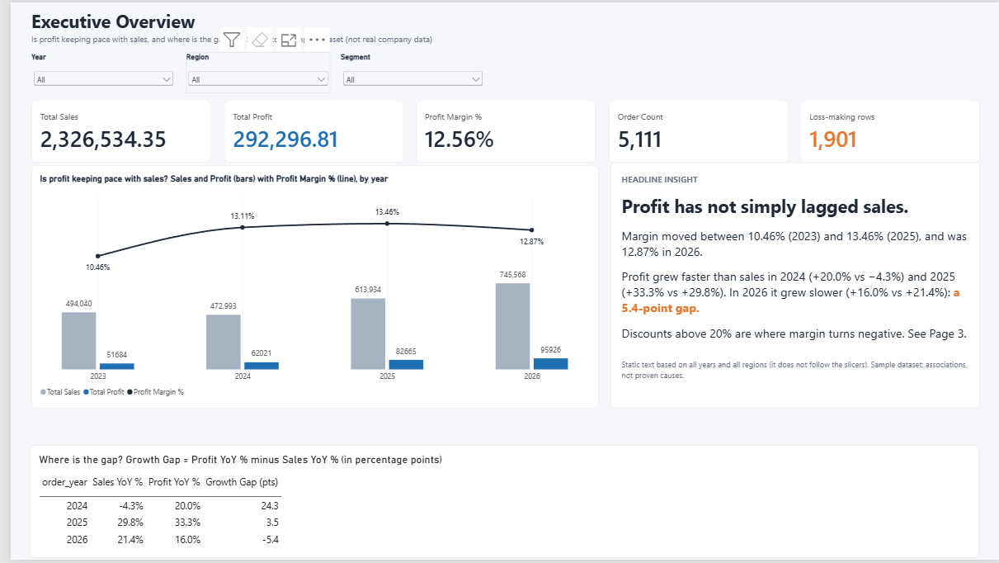
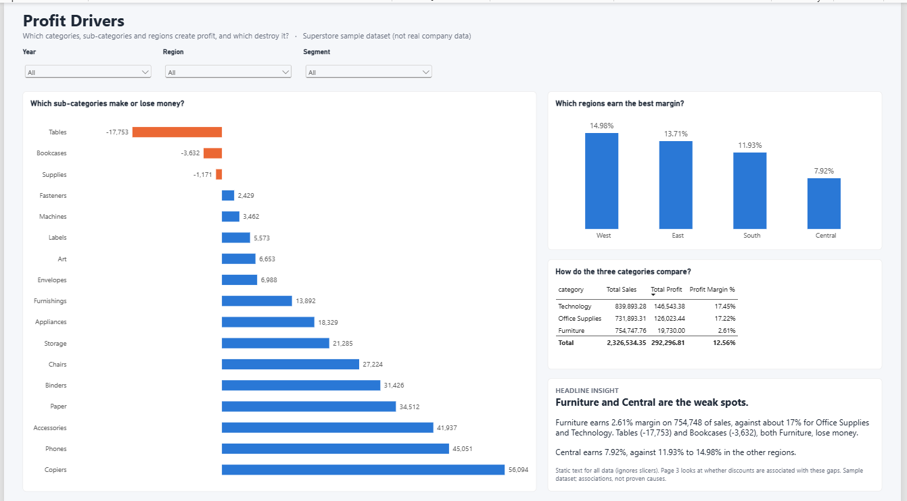
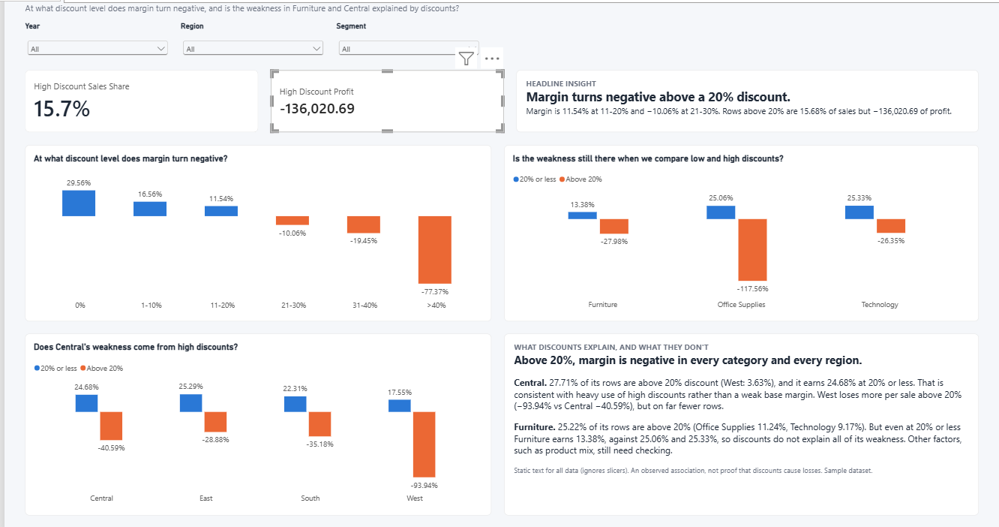

# Profitability Diagnosis: Why Is Profit Not Keeping Pace With Sales?

An end-to-end analysis of Tableau's **Sample Superstore** data (10,194 order rows, 2023–2026)
using **Python, Excel, SQL (MySQL) and Power BI**. The question started as "why is profit
lagging sales?", and the first result was that the premise is only partly true.

> **Data note:** Superstore is a public *sample dataset*, not real company data. It includes
> 200 Canadian rows (about 2% of rows); all analysis uses all 10,194 rows. Findings show
> associations, not proven causes, and there is no cost or price-elasticity data.

## Key findings

- **Profit has not simply lagged sales.** Profit grew every year; margin ranged from 10.46% (2023)
  to 13.46% (2025), ending at 12.87% in 2026 (profit +16.0% vs sales +21.4%).
- **Margin turns negative above a 20% discount.** Rows above 20% discount (1,415 rows) are
  15.68% of sales but hold a net loss of **136,021**. Overall margin is 12.56%.
- **The pattern holds within the same sub-category:** Binders +40.89% → −106.54%, Machines
  +29.20% → −38.46%, Tables +11.11% → −33.96%, Bookcases +8.84% → −39.37%.
- **Central is exposed to discounts, not inherently weak:** 27.71% of its rows are above 20%
  discount (West 3.63%); it earns 24.68% at 20% or less.
- **Furniture (2.61% margin) is weak even at low discount**, so discounts do not explain everything.
- **Illustrative impact:** cutting the loss on rows above 20% discount by 25% / 50% / 100% would
  lift margin from 12.56% to 14.03% / 15.49% / 18.41% (sales held constant, not a forecast).

Recommendation: [`docs/recommendation.md`](docs/recommendation.md) · Details: [`docs/findings.md`](docs/findings.md)

## Dashboard (Power BI)

| Executive overview | Profit drivers | Discount and loss |
|---|---|---|
|  |  |  |

File: [`powerbi/profitability_dashboard.pbix`](powerbi/profitability_dashboard.pbix).
Slicers for year, region and segment are synced across pages; a Reconciliation page shows the totals.

## Workflow

```text
Raw data -> Python profiling -> Cleaning (logged) -> Excel pivots
-> SQL analysis -> Reconciliation across tools -> Python EDA
-> Power BI dashboard -> One-page recommendation
```

| Phase | Tool | What it does |
|---|---|---|
| 1. Profiling | Python (pandas) | Shape, types, nulls, duplicates; tests the premise before cleaning |
| 2. Cleaning | Python | Typed columns, zero-padded US postal codes, helper columns; changes logged in `docs/data_quality_log.md` |
| 3. First pass | Excel | Pivots by year, category, region, segment, discount band; baseline totals |
| 4. Analysis | MySQL | 13 numbered queries: yearly trend (LAG), discount bands, sub-category and region by discount, sensitivity check, scenarios |
| 5. EDA | Python (matplotlib) | Charts: margin by discount band, low vs high discount, profit by sub-category, region |
| 6. Dashboard | Power BI + DAX | Three pages; measures for margin, YoY, growth gap, high-discount share |
| 7. Packaging | Markdown | Findings, recommendation memo, KPI definitions, this README |

## Reconciliation

Totals were checked in every tool before any story was written.

| Check | Result |
|---|---|
| Total sales | 2,326,534.35 |
| Total profit | 292,296.81 |
| Margin (SUM profit / SUM sales) | 12.56% |
| Yearly margin 2023 / 2024 / 2025 / 2026 | 10.46% / 13.11% / 13.46% / 12.87% |
| Rows above 20% discount | 1,415 (profit −136,020.69) |

Python, Excel, SQL and Power BI agree on these. Comparing tools also caught two problems:
two SQL queries (07 and 08) were silently filtering to US rows only, and an early Excel pivot
total was one row short. Both were fixed. Details: [`docs/reconciliation.md`](docs/reconciliation.md).

## Project structure

```text
Profitability-Diagnosis/
├── data/raw/                 Superstore.xls (not committed)
├── data/clean/               cleaned CSV/XLSX (not committed, rebuilt by notebook 02)
├── notebook/                 01_data_profiling, 02_data_cleaning, 03_load_to_mysql, 04_eda
├── sql/                      01_create_table ... 13_discount_scenarios
├── excel/                    profitability_analysis.xlsx (pivots, baseline)
├── powerbi/                  profitability_dashboard.pbix
├── docs/                     business_questions, kpi_definitions, data_quality_log,
│                             findings, reconciliation, recommendation, images/
└── README.md
```

## How to reproduce

1. Download **Sample - Superstore** (the Orders sheet) from Tableau's sample data page and save it as
   `data/raw/Superstore.xls`.
2. Create a virtual environment and install: `pandas`, `matplotlib`, `openpyxl`, `xlrd`, `sqlalchemy`, `pymysql`, `jupyter`.
3. Run `notebook/01_data_profiling.ipynb`, then `02_data_cleaning.ipynb`. The assertions in the cleaning
   notebook check 10,194 rows, sales 2,326,534.35 and profit 292,296.81.
4. In MySQL create a database named `profitability`, run `sql/01_create_table.sql`, then run
   `notebook/03_load_to_mysql.ipynb` once (it asks for your MySQL password and does not store it).
5. Run `sql/02` to `sql/13` in order. Query 02 re-checks the totals.
6. Run `notebook/04_eda.ipynb` for the charts.
7. Open `powerbi/profitability_dashboard.pbix`. The data source points to a file on the author's computer;
   to refresh, point it at your own `data/clean/superstore_clean.csv`.

## Limitations

- Sample dataset, not real company data. It includes 200 Canadian rows (about 2% of rows).
- No cost, price-elasticity or customer data. Lower discounts may reduce volume.
- Findings are associations, not proven causes. Scenario figures are illustrative upper bounds.
- The 8 most extreme rows exaggerate the 2026 margin slip by about 40% (sensitivity check in SQL 12);
  the direction of the findings holds without them.
- Open questions: why Supplies loses money with no high discounts, why Machines' low-discount profit
  fell in 2026, why West's low-discount margin is lowest, and why Furniture is weak even at low discount.